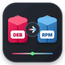

# DEB to RPM Converter (`deb2rpm`)

<p align="center">
  
</p>

<p align="center">
  <b>A modern, native graphical utility and CLI tool for Fedora Linux to convert Debian (<code>.deb</code>) packages into RPM (<code>.rpm</code>) packages.</b>
</p>

<p align="center">
  
  
  
</p>

---

## ✨ Features

- **Native Qt6 Interface**: Clean, modern graphical application built with PyQt6 (with PySide6 fallback), styled beautifully for Fedora KDE Plasma and GNOME.
- **Drag & Drop**: Simply drag `.deb` packages from Dolphin, Nautilus, or your browser straight into the application window.
- **File Manager Integration**: Right-click any `.deb` file in your file manager and choose **"Open With -> DEB to RPM Converter"** to start converting instantly.
- **Batch Processing**: Queue and convert multiple Debian packages simultaneously.
- **Rootless & Safe**: Utilizes `fakeroot` to ensure file ownership and permissions in the generated RPM are correct without requiring root privileges during build.
- **Configurable Options**:
  - Keep original package release versions (`-k / --keep-version`)
  - Preserve package pre/post maintainer scripts (`-c / --scripts`)
  - Sanitize file permissions (`--fixperms`)
  - Custom output directory selector
  - Auto-open destination folder when finished
- **1-Click Installation**: Optional checkbox and button to immediately install the generated RPM packages with Fedora's `dnf` using Polkit (`pkexec`).
- **Dependency Sentinel**: Automatically detects whether required tools (`alien`, `fakeroot`, `rpm-build`) are installed and provides a 1-click installation banner.
- **Full CLI Mode**: Scriptable command-line interface for headless systems or terminal power users (`deb2rpm --cli file.deb`).

---

## 📋 Requirements

`deb2rpm` requires Python 3, Qt6 (`python3-pyqt6` or `python3-pyside6`), `alien`, `fakeroot`, and `rpm-build`.

On Fedora, install the prerequisites with:

```bash
sudo dnf install -y alien fakeroot rpm-build python3-pyqt6
```

*(If any are missing when you open the GUI, `deb2rpm` will notify you and offer to install them automatically).*

---

## 🚀 Installation

Clone the repository and run the installer script:

```bash
git clone https://github.com/FAKERH0G/deb2rpm-gui.git
cd deb2rpm-gui
./install.sh
```

### System-Wide Installation (Optional)

To install system-wide for all users:

```bash
sudo ./install.sh --system
```

The installer configures:
- `deb2rpm` and `deb2rpm-gui` in your `PATH` (`~/.local/bin` or `/usr/local/bin`).
- Desktop launcher in your Application Menu under Utilities.
- High-resolution SVG application icon.
- MIME type association for `.deb` files in Dolphin and GNOME Files.

---

## 🖥 Usage

### Graphical Mode

Launch the app from your application launcher or by running:

```bash
deb2rpm
```

You can also pass files directly to open them in the converter:

```bash
deb2rpm /path/to/software.deb
```

1. **Add files**: Drag and drop `.deb` files into the window, or click **"Add .deb Files..."**.
2. **Configure options**: Choose your output folder (or keep the default: same as source), and toggle version/script preservation.
3. **Convert**: Click **"🚀 Convert to RPM"**.
4. **Done**: Click **"📂 Open Destination"** to view your RPM or **"📥 Install RPM"** to install it via DNF.

---

### Command-Line (CLI) Mode

Convert packages directly from your terminal:

```bash
# Convert a package
deb2rpm --cli package.deb

# Convert multiple packages to a custom destination directory
deb2rpm --cli -o ~/Downloads pkg1.deb pkg2.deb

# Convert and automatically install with DNF
deb2rpm --cli -i package.deb
```

#### CLI Options

| Option | Description |
| :--- | :--- |
| `files ...` | One or more `.deb` package paths |
| `-o, --output <DIR>` | Output directory for generated `.rpm` files |
| `--cli` | Run in headless CLI mode |
| `-k, --keep-version` | Preserve upstream package version (default: True) |
| `-c, --scripts` | Include maintainer scripts (default: True) |
| `--fixperms` | Sanitize and fix file permissions |
| `-i, --install` | Automatically install generated RPMs with DNF |
| `-h, --help` | Show command usage and exit |

---

## 🗑 Uninstallation

To remove `deb2rpm`, run:

```bash
./uninstall.sh
```

*(Add `--system` if you performed a system-wide installation).*

---

## 📄 License

This project is open-source and licensed under the [MIT License](LICENSE).
